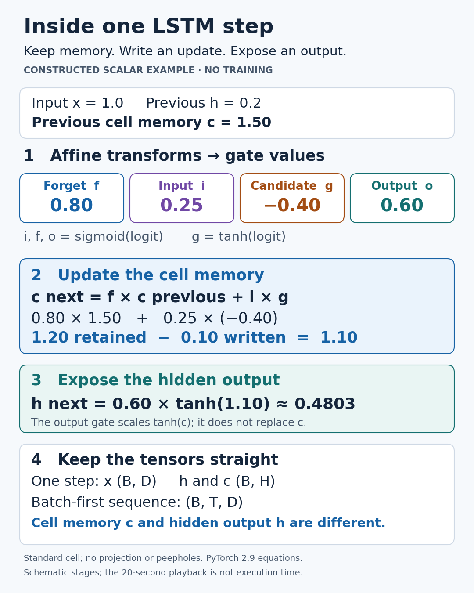

# Sequence Learning Lab

Small, inspectable sequence-learning implementations and reproducible educational experiments. The first release explains **one standard LSTM cell step**, with checked NumPy arithmetic and original visual assets.

**24 October addition:** [LSTM versus GRU: states, gates and parameter counts](comparisons/2026-10-24/README.md) adds a checked GRU implementation, NumPy/PyTorch parity, exact parameter-count audits and original PNG/SVG/GIF teaching assets. Follow its separate install/run instructions. The historical release below remains documented as it was executed; its old MP4 is preserved. New media are static images or animated GIFs only.

This release is a tutorial, **not a trained activity classifier, a performance benchmark or a production library**. Every example input and parameter is authored and synthetic. No dataset download, account, API key or GPU is required.

## Run locally

Python 3.12 was used. Create an isolated environment and install dependencies:

```sh
python -m venv .venv
# Windows: .venv\Scripts\activate
# macOS/Linux: source .venv/bin/activate
python -m pip install -r requirements.txt
python -m unittest -v
python tutorial.py
python render_tutorial.py --video
```

The numerical example only needs NumPy. Matplotlib creates the SVG/PNG; the optional silent MP4 uses imageio-ffmpeg's packaged FFmpeg. Animation stages are schematic, not measured runtime. See [PROTOCOL.md](PROTOCOL.md) for the scope declared before execution.

## What to inspect

[`lstm_cell.py`](lstm_cell.py) implements batched input/forget/candidate/output gates in **i,f,g,o** order:

```text
z = x @ W_ih.T + b_ih + h_previous @ W_hh.T + b_hh
i, f, g, o = sigmoid(z_i), sigmoid(z_f), tanh(z_g), sigmoid(z_o)
c_next = f * c_previous + i * g
h_next = o * tanh(c_next)
```

Multiplications in the state update are elementwise. One step takes x `(B,D)` and h/c `(B,H)`. Weight shapes are `(4H,D)` and `(4H,H)`; each bias has shape `(4H,)`. The included `unroll` helper explicitly accepts batch-first `(B,T,D)`; PyTorch's `LSTM` module defaults to time-first unless `batch_first=True`. `LSTMCell` itself takes one timestep, not a full 3-D sequence. Return order is **h, c**.

The deliberately constructed scalar example has previous c=1.5, i=0.25, f=0.8, candidate g=-0.4 and o=0.6:

| Term | Executed value |
|---|---:|
| Retained memory f*c_previous | 1.2 |
| Candidate write i*g | -0.1 |
| New cell c_next | 1.1 |
| Hidden output o*tanh(c_next) | 0.4802994131 |

The candidate can be negative; an input gate does not mean 'add a positive quantity'. Cell memory and hidden output are different tensors. The output gate controls the exposed hidden output; it does not erase the cell memory. The cell state is not constrained to [-1,1], although this unprojected cell's hidden output is bounded by tanh and its output gate.



Try changing `c` in `worked_parameters()` and rerun. Then change the constructed gates carefully, preserving the i,f,g,o order. Do not infer real model accuracy or a best architecture from these illustrative numbers.

## Verification and limits

An independently written scalar-loop oracle checks multiple batched shapes and each unrolled timestep. Tests also check hand arithmetic, repeatability, batch independence, finite/shape errors, both biases, saturation and the fixed-gate memory path. See saved [executed outputs](results/2026-10-20.json) and [check record](results/checks.json).

No training, learned weights, real-data evaluation, automatic differentiation or framework-parity run was performed. The equations and packing follow the tagged official PyTorch 2.9 documentation/source; **PyTorch is not installed or required**. This implementation omits projection, peepholes, dropout, masking, bidirectionality and optimization. A fixed-gate partial derivative is not the total recurrent-network gradient, and LSTMs do not guarantee unlimited memory or eliminate vanishing/exploding gradients. This release has no browser UI or hosted demo.

## Sources and licence

Consulted 20 October 2026:

- [Official PyTorch 2.9 LSTMCell reference](https://docs.pytorch.org/docs/2.9/generated/torch.nn.LSTMCell.html): equations, shapes and return order.
- [Official tagged implementation/docstring](https://github.com/pytorch/pytorch/blob/v2.9.0/torch/nn/modules/rnn.py): packed weight conventions.
- [Official PyTorch 2.9 LSTM reference](https://docs.pytorch.org/docs/2.9/generated/torch.nn.LSTM.html): sequence axes and `batch_first` behavior.

Detailed source and access records are in [sources.json](sources.json). No third-party code, paper text, logo or diagram is redistributed. Original code, illustrative inputs, results and artwork are MIT licensed; the sources retain their own licences. This is an explanation of an established method, without a scientific-novelty claim.
