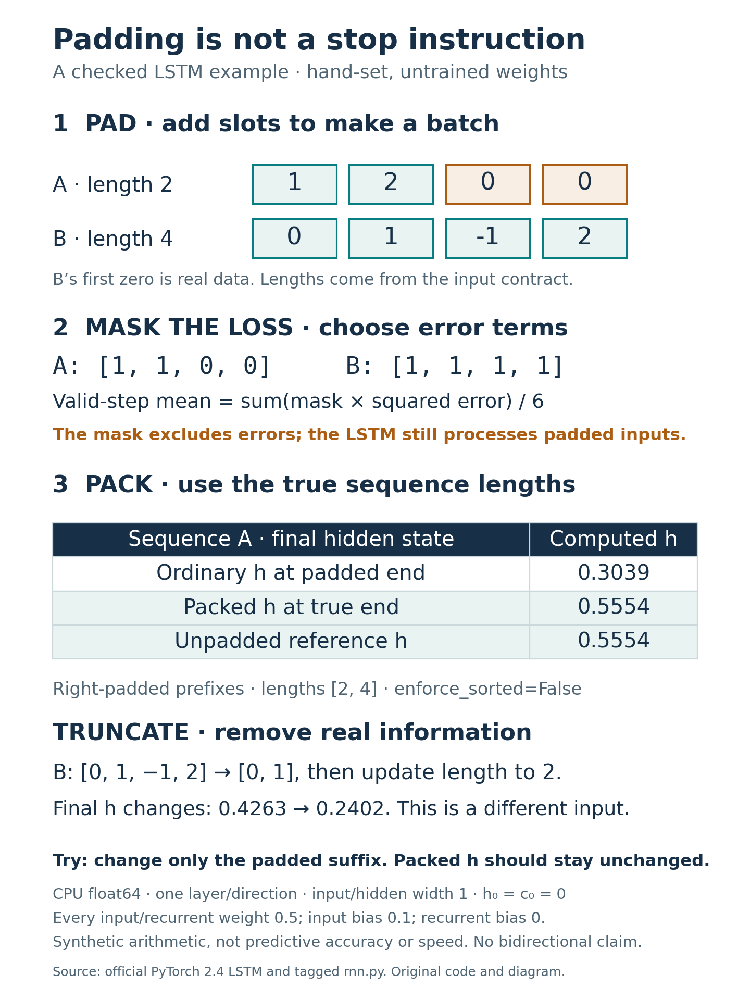

# Padding, truncation and loss masking change different things

This is an original educational example with explicitly assigned **untrained**
LSTM weights and synthetic ordered inputs. It is not a new model, trained activity
classifier, real-data benchmark or speed comparison. No UCI data are used.

Padding adds slots so sequences can share a tensor shape. Truncation removes
observations. A loss mask controls which errors enter a reduction; it does not
automatically stop a PyTorch LSTM from processing padding.

## Run and inspect

Python3.12, CPU only, no API key/data download:

```sh
python -m pip install -r requirements-padding.txt
python -m pip install torch==2.4.0 --index-url https://download.pytorch.org/whl/cpu
python padding_demo.py
python -m unittest -v
python render_padding.py
```

Default results path is this folder's results.json; `--output` accepts another
path. New graphics are PNG/SVG only. Historical MP4 assets remain unchanged;
this tutorial creates no video. See [declaration](PROTOCOL.md), [source ledger](sources.json),
[actual outputs](results.json), [stdout](execution-stdout.txt) and [checks](checks.json).

The scalar LSTM has input/recurrent weights0.5, input biases0.1 and recurrent
biases0, initial h=c=0. At each step z=.5x+.5h+.1, input/forget/output gates are
sigmoid(z), candidate is tanh(z), then c=f*c+i*g and h=o*tanh(c).
PyTorch's actual float64 outputs are checked against this separately written
Python scalar loop; no random used weights or outcomes selected from a sweep.

A=[1,2], B=[0,1,-1,2], explicit lengths[2,4]. Right-pad A with two zeros. B's
first zero is valid data. Inferring lengths from nonzero counts would remove it.

| A hidden state | Actual h |
|---|---:|
| Ordinary LSTM at padded end |0.3038844850860214|
| Last valid ordinary output |0.5553963082983773|
| Packed final hidden state |0.5553963082983773|
| Unpadded reference |0.5553963082983773|

The ordinary LSTM processes both padded zeros. Zero input is not an identity
state transition: recurrent terms, biases and gate updates still act. Replacing
only the padded values with9 changes ordinary final h to0.9875144339756489 while
packed final h and the valid forward-only outputs stay unchanged.

For squared output error against0, the valid-step mask contains6 positions.
Its mean is0.0992397868025613. A naive mean over all8 padded positions gives
0.10386677587163644. This changes loss accounting, not forward recurrence.
Packed final-state loss has exactly zero gradients at padded inputs in the example.

```python
from torch.nn.utils.rnn import pack_padded_sequence
lengths = lengths_for(x, [2, 4])  # checked CPU int64, one length per row
packed_input = pack_padded_sequence(
    x, lengths, batch_first=True, enforce_sorted=False
)
_, (h, c) = model(packed_input)
```

The complete callable example is `padding_demo.example()`. Internal sorting
restores final h/c to the original batch order, checked against individual runs.
Correct lengths are essential: supplying1 for A silently drops its second real
step. The wrapper rejects non-integer/zero/negative/oversize lengths and wrong
batch counts. It assumes valid prefixes/right padding; it cannot detect a
semantically incorrect positive length merely from values.

Explicitly truncating B to its first2 steps updates its length to2 and changes
h from0.42627125755478523 to0.24018874272550528. That is a different input,
not removal of padding. Try changing padding values separately from valid values.



## Scope and checks

One layer, forward-only, no projection/dropout, CPU float64. Last-valid-output
gathering agrees here; do not apply that shortcut to bidirectional final states.
Packing handles recurrence lengths, but downstream losses/pooling still need
correct alignment/masks if unpacked outputs are used. No claim packing is faster
was measured.32 local tests passed, including7 new checks for scalar/standalone
parity, real zeros, nontrivial zero padding, loss denominator, sorting, extra
padding, gradients, malformed lengths and explicit truncation. Full outputs stay
visible; tolerance1e-14, not general exact floating-point equality.

All inputs, code and artwork are authored under the existing MIT licence.
Official PyTorch2.4 equations and tagged source support method/API definitions;
their code/text/artwork are not copied into this repository. No scientific
novelty, performance benefit or practical task accuracy is claimed.

The initial CI failure exposed a missing optional Matplotlib metadata dependency.
[Environment fix](environment-fix.json) preserves the original declaration/hash,
records both code versions and verifies identical numerical arrays. Numerical
checks now run without Matplotlib installed; only rendering requires it.
